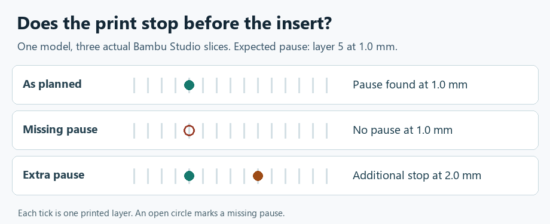

# Bambu Pause Check

Check whether manual pauses in a sliced Bambu Studio plate match the layers or heights you intended before embedding magnets or nuts.

**[Download v0.1.0 ZIP](https://github.com/Uone100/bambu-pause-check/releases/download/v0.1.0/bambu-pause-check-0.1.0.zip)** · **[English tutorial and worked examples](TUTORIAL.md)** · [All releases](https://github.com/Uone100/bambu-pause-check/releases)



## Install for Codex in one command

From your project, with Node.js 22.20 or newer:

```sh
npx skills add Uone100/bambu-pause-check -a codex
```

Start a new Codex session in that project. For standalone use, download the ZIP and follow the quickstart below.

## Quickstart

Extract the ZIP. Open a terminal in the folder containing `SKILL.md`.

With Python 3.9 or newer, run the included slice excerpt through the checker.

```sh
python scripts/check_pauses.py examples/good.gcode --height 1.0
```

Expected output: `match`, layer 5, height 1 mm. The tutorial includes missing and extra pauses and multi-plate usage.

## Use with an agent

Put the extracted files under `.agents/skills/bambu-pause-check/` in a Codex project or `.claude/skills/bambu-pause-check/` in a Claude Code project. Start a new session. Try this request and supply your files:

> Check plate 2 of this sliced 3MF for exactly one manual pause at 6.4 mm. List unexpected stops and the lines to inspect.

Users have reported [pauses omitted after editing](https://github.com/bambulab/BambuStudio/issues/9369) and [persistent pauses on a reused plate](https://github.com/OrcaSlicer/OrcaSlicer/issues/15382). The comparison reads the exported plate offline.
